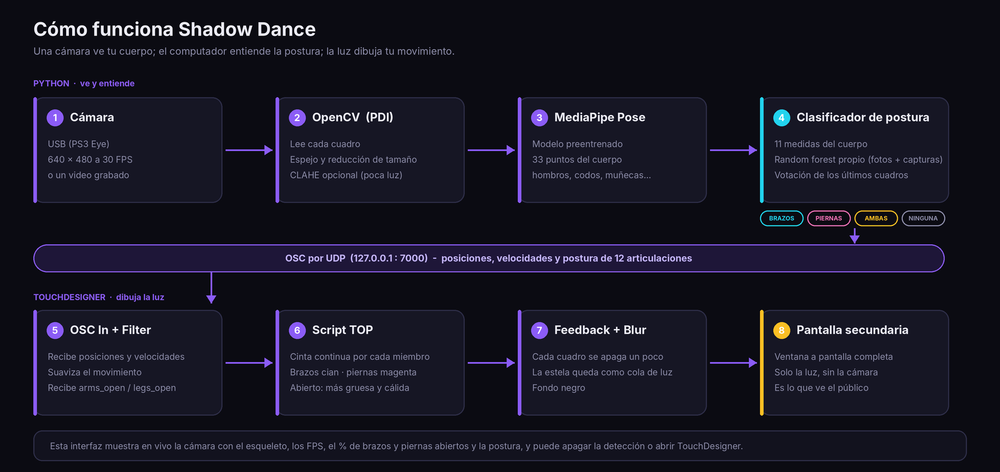
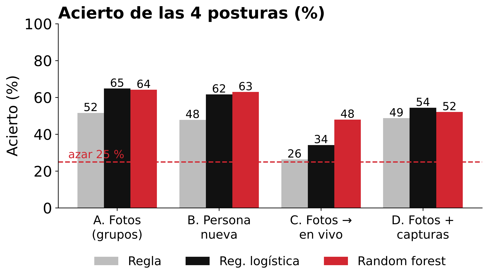
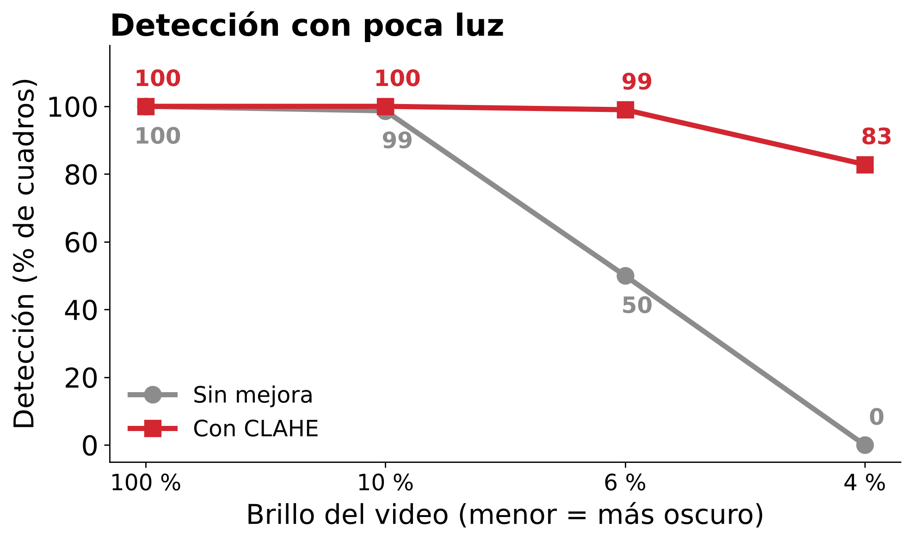

# ShadowDance

**Tu cuerpo dibuja la luz.** Una cámara capta a una persona, un modelo de visión detecta su pose, un clasificador decide si abre los brazos, las piernas, ambos o ninguno, y TouchDesigner dibuja en una pantalla secundaria estelas de luz que reaccionan a esa postura, en tiempo real.

Proyecto final de **Procesamiento Digital de Imágenes (PDI)** · Universidad Autónoma de Occidente, Cali · Profesor: Nicolás Llanos Neuta

**Equipo:** Sebastián Meneses Molina · Juan Camilo Trujillo Vargas · Fanier Andrés Candelo Triana



## Contenido

1. [Descripción del proyecto](#1-descripción-del-proyecto)
2. [Arquitectura del sistema](#2-arquitectura-del-sistema)
3. [Metodología](#3-metodología)
4. [Implementación](#4-implementación)
5. [Datos](#5-datos)
6. [Interfaz gráfica (GUI)](#6-interfaz-gráfica-gui)
7. [Resultados](#7-resultados)
8. [Conclusiones](#8-conclusiones)

Anexos: [Cómo ejecutarlo](#cómo-ejecutarlo) · [Estructura del repositorio](#estructura-del-repositorio) · [Referencias](#referencias)

---

## 1. Descripción del proyecto

**Problema.** Las instalaciones interactivas de luz suelen depender de sensores especiales o de controles manuales. Queremos que el cuerpo sea el control, usando solo una cámara web común.

**Objetivo.** Construir un sistema interactivo en tiempo real que (a) detecte el cuerpo de una persona con visión por computador, (b) reconozca una postura sencilla (brazos abiertos, piernas abiertas) y (c) la convierta en una obra visual de luz, evaluando el sistema con datos reales y métricas cuantitativas.

**Qué hace.**

- Detecta 12 articulaciones (hombros, codos, muñecas, caderas, rodillas, tobillos) con MediaPipe Pose.
- Clasifica la postura en 4 clases: `ninguna`, `brazos`, `piernas`, `ambas`.
- Manda los datos por OSC a TouchDesigner, que dibuja cintas de luz que se apagan solas. Cuando se abren los brazos la estela de brazos se vuelve dorada y más gruesa; con las piernas, naranja.
- Tiene una interfaz gráfica para ejecutar con cámara, probar con videos grabados y ver el rendimiento en vivo.
- Incluye una mejora de imagen (CLAHE) para funcionar con poca luz.

**Inspiración.** *Text Rain* (Utterback y Achituv, 1999) y las obras de referencia del laboratorio (*Data Choreographics*, *Illuminate*): instalaciones donde el cuerpo del visitante transforma la imagen.

## 2. Arquitectura del sistema

```
Cámara / video ─► (CLAHE opcional) ─► MediaPipe Pose ─► Características geométricas
                                                            │
                                    Clasificador (2 preguntas sí/no → 4 clases)
                                                            │
                         Suavizado + velocidad ─► OSC (UDP 127.0.0.1:7000) ─► TouchDesigner ─► pantalla secundaria
```

| Etapa | Qué hace | Dónde |
|---|---|---|
| Captura | Cámara (DirectShow, 640×480) o video | `src/pose_osc.py`, `INTERFAZ/motor.py` |
| Mejora de imagen | CLAHE sobre el canal L de LAB | `src/evaluar_sistema.py` (`ecualizar_clahe`) |
| Pose | MediaPipe Pose Landmarker (`pose_landmarker_full.task`) | `src/pose_osc.py` |
| Postura | 11 características normalizadas + clasificador | `src/postura.py` |
| Comunicación | OSC por UDP, puerto 7000 | `src/pose_osc.py` |
| Visualización | Estelas de luz (Script TOP + Feedback) | `touchdesigner/` |
| Interfaz | Servidor local + página web | `INTERFAZ/` |

**Contrato OSC** (direcciones que recibe TouchDesigner):

| Dirección | Valor |
|---|---|
| `/{articulación}_x`, `/{articulación}_y` | posición suavizada, 0 a 1 (12 articulaciones) |
| `/{articulación}_s` | velocidad de esa articulación |
| `/detected` | 1 si hay persona, 0 si no |
| `/posture` | 0 ninguna · 1 brazos · 2 piernas · 3 ambas |
| `/arms_open`, `/legs_open` | 1 si los brazos / las piernas están abiertos |

## 3. Metodología

**Pose.** MediaPipe Pose Landmarker en modo video (sigue a la persona entre cuadros). Se usan 12 de los 33 puntos.

**Características (11).** Todas se normalizan por el tamaño del torso para no depender de qué tan cerca está la persona: altura y distancia de muñecas, distancia de tobillos y de rodillas, ancho de hombros, ángulos de codo y rodilla, extensión del brazo, tobillos contra hombros, altura de tobillos.

**Dos preguntas sí/no en vez de 4 clases directas.** Se entrenan dos clasificadores binarios (`abre_brazos`, `abre_piernas`) y se combinan en las 4 posturas. Así cada modelo resuelve algo más simple y la salida se puede usar por separado para colorear brazos y piernas.

**Modelos comparados.** Regla de un umbral (línea base), regresión logística y random forest (300 árboles).

**En vivo.** Se clasifica 1 de cada 3 cuadros y se vota por mayoría sobre las últimas 5 predicciones, para evitar parpadeos.

**Procesamiento de imágenes (PDI).** Se probó **CLAHE** (ecualización adaptativa de histograma con límite de contraste: canal L de LAB, `clip=2.0`, bloques 8×8) antes de MediaPipe, oscureciendo artificialmente los videos de prueba para medir cuánta luz hace falta.

**Evaluación.** Cuatro esquemas, de más fácil a más exigente, siempre separando personas o sesiones entre entrenamiento y prueba:

| Esquema | Entrena con | Prueba con |
|---|---|---|
| A | Fotos | Las mismas fotos, validación cruzada **por grupos** (5 pliegues) |
| B | Fotos de una persona | Fotos de la otra persona (en los dos sentidos) |
| C | Todas las fotos | 3 900 cuadros capturados en vivo |
| D | Fotos + capturas en vivo | Una sesión en vivo que se deja fuera cada vez |

## 4. Implementación

- **Lenguaje y librerías:** Python 3, MediaPipe, OpenCV, NumPy, pandas, scikit-learn, joblib, python-osc, Pillow.
- **TouchDesigner 2025:** OSC In → Filter CHOP → Script TOP (`touchdesigner/td_segmentos.py`) → Composite + Feedback + Level + Blur → ventana de salida (Window COMP).
- **Archivos principales:**

| Archivo | Función |
|---|---|
| `src/pose_osc.py` | Programa en vivo por consola: cámara → pose → postura → OSC |
| `src/postura.py` | Características y clasificador en vivo (`ClasificadorVivo`) |
| `src/extraer_puntos.py` | Extrae los puntos de pose de las fotos del laboratorio a `data/keypoints.csv` |
| `src/capturar_postura.py` | Captura cuadros etiquetados en vivo a un CSV (teclas 1 a 4) |
| `src/entrenar_clasificador.py` | Entrena y evalúa (esquemas A a D); guarda el modelo con `--guardar` |
| `src/evaluar_sistema.py` | Mide detección, tiempo por cuadro y FPS con y sin CLAHE y con distintas luces |
| `src/grabar_video.py` | Graba los 4 videos de prueba de un usuario (quieto, brazos, piernas, ambas) |
| `src/optimizar_video.py` | Crea una copia liviana de un video de celular (4K) para verlo fluido en la interfaz |
| `src/diagnostico_rendimiento.py` | Mide cuánto tarda cada etapa de un cuadro en el computador donde se ejecuta |
| `src/listar_camaras.py` | Muestra qué número tiene cada cámara conectada |
| `src/osc_simulador.py` | Envía OSC inventado a TouchDesigner para probar la estela sin cámara |
| `INTERFAZ/` | Interfaz gráfica (ver sección 6) |
| `touchdesigner/` | Proyecto `.toe` y script de las estelas |

## 5. Datos

| Conjunto | Contenido | Archivo |
|---|---|---|
| Fotos del laboratorio | 159 fotos de **adultos** usadas para entrenar (puntos de pose ya extraídos, sin las imágenes) | `data/keypoints.csv` |
| Capturas en vivo | 3 900 cuadros etiquetados de 2 personas con las 4 posturas | `data/captura_v1.csv` |
| Videos de prueba | Dos videos del laboratorio (brazos, piernas) más videos propios | no se suben |

Notas honestas sobre los datos:

- Las etiquetas de las fotos se asignaron según la categoría del laboratorio (brazos, piernas, ambas); no se etiquetó manualmente foto por foto.
- Las fotos no tienen ejemplos de la clase `ninguna`; esa clase solo aparece en las capturas en vivo.
- Las fotos originales, los videos y los modelos pesados **no se suben al repositorio** por privacidad (hay personas, entre ellas un menor) y por tamaño. Solo se publican los puntos de pose, que no permiten reconstruir a nadie.

## 6. Interfaz gráfica (GUI)

Interfaz local que se abre en una ventana propia (Edge en modo aplicación). Funciona con la biblioteca estándar de Python y una página web.

```
python INTERFAZ\iniciar.py
```

| Pantalla | Para qué sirve |
|---|---|
| **Inicio** | Menú principal con el título, los creadores y la materia |
| **Ejecutar** | Cámara con el esqueleto de brazos y piernas, FPS, % de cuerpo visible, % de brazos y piernas abiertos, tiempo por cuadro y la postura detectada (BRAZOS / PIERNAS / AMBAS / NINGUNA). Interruptores para encender o apagar la detección y la mejora de luz (CLAHE) |
| **Pruebas** | Reproduce videos grabados con la detección encima (pausa, reiniciar, repetir) y muestra las mediciones guardadas en `results/` |
| **Cómo funciona** | El diagrama de arquitectura |

> **Captura de pantalla:** `docs/gui_ejecutar.png` *(agregar)*

**Rendimiento:** si el computador no alcanza a detectar en cada cuadro, la interfaz activa sola un *modo adaptativo* (detecta 1 de cada 2 cuadros y reutiliza la última pose), de modo que el video y el dibujo siguen fluidos. Los videos de prueba se guardan en `INTERFAZ/videos/usuarios/` (no se suben a GitHub).

La interfaz **no abre TouchDesigner**: se abre `touchdesigner/shadowdance3.toe` a mano antes de iniciar y, en TouchDesigner, **F1** abre la ventana negra de salida (la pantalla secundaria) y **Esc** la cierra. Más detalles en `INTERFAZ/LEEME.md`.

## 7. Resultados

### 7.1 Clasificador de postura

Acierto promedio (ponderado por número de ejemplos) de las 4 posturas completas, que es lo más exigente. El azar sería 25 %.

| Esquema | Regla (1 umbral) | Regresión logística | Random forest |
|---|---|---|---|
| A. Fotos, validación cruzada por grupos | 52 % | **65 %** | 64 % |
| B. Entrenar con una persona, probar con otra | 48 % | 62 % | **63 %** |
| C. Fotos → cuadros en vivo | 26 % | 34 % | **48 %** |
| D. Fotos + capturas, dejando una sesión fuera | 49 % | **54 %** | 52 % |



Cada pregunta por separado acierta más (hasta ~75 % en `abre_brazos` y `abre_piernas`); las gráficas están en `poster/figuras/fig_acierto_brazos.png` y `fig_acierto_piernas.png`, y las tablas completas con F1 en `results/clasificador_resumen.md`. Las matrices de confusión están en `results/matriz_confusion_*.png`.

**Qué enseña la comparación:**

- Entrenar solo con fotos y probar en vivo (esquema C) baja mucho el acierto: las fotos y la cámara web no se parecen. Agregar capturas en vivo al entrenamiento (esquema D) sube el acierto de 48 % a 52–54 % con modelos más estables.
- La regla de un umbral sirve como línea base, pero los modelos aprendidos la superan en casi todos los esquemas.
- Las características más importantes para `abre_brazos` son la **altura de las muñecas** (máxima y media) y su **distancia**.

### 7.2 Imagen y velocidad (PDI)

Porcentaje de cuadros con persona detectada, promedio de los dos videos del laboratorio (300 cuadros cada uno), oscureciendo el video de forma artificial:

| Brillo del video | Sin mejora | Con CLAHE |
|---|---|---|
| 100 % (original) | 100 % | 100 % |
| 10 % | 98.7 % | 100 % |
| 6 % | 50 % | 99 % |
| 4 % | 0 % | 82.8 % |



- Con muy poca luz, MediaPipe deja de detectar a la persona; **CLAHE recupera la detección** (de 0 % a 83 % con el 4 % del brillo; en ese caso extremo, el video de brazos solo llega a 66 % y el de piernas a 100 %).
- **Costo de CLAHE:** unos 3 ms por cuadro (≈22.5 ms sin CLAHE frente a ≈25.5 ms con CLAHE), así que el sistema se mantiene en tiempo real: ≈44 FPS posibles sin CLAHE y ≈40 con CLAHE.
- **Velocidad en vivo:** entre **27 y 30 FPS** con la cámara a 640×480 (la cámara limita a 30). Con poca luz la cámara web baja sola sus cuadros por segundo. Los números de cada condición están en `results/sistema_metricas.csv`, y `python src\diagnostico_rendimiento.py` mide las etapas en cualquier computador.

### 7.3 Evidencia visual

- Interfaz en funcionamiento: sección 6.
- Estelas de luz en TouchDesigner, con los brazos y las piernas abiertos: *(agregar capturas en `docs/`)*.
- Videos con el esqueleto detectado: se generan desde la pestaña **Pruebas**.

### 7.4 Pruebas con usuarios

Piloto con adultos que prueban el prototipo. Cada uno graba 4 videos de 10 s con `python src\grabar_video.py` (quieto, brazos abiertos, piernas abiertas, ambas) y se miden con `python src\evaluar_sistema.py --videos ...`. Los resultados quedan en `results/usuarios/`.

| Usuario | Quieto | Brazos | Piernas | Ambas |
|---|---|---|---|---|
| Usuario 1 | [__ %] | [__ %] | [__ %] | [__ %] |
| Usuario 2 | [__ %] | [__ %] | [__ %] | [__ %] |
| Usuario 3 | [__ %] | [__ %] | [__ %] | [__ %] |

*(porcentaje de cuadros con la postura correcta; completar con `results/usuarios/sistema_resumen.md`)*

## 8. Conclusiones

**Logros**

- Sistema completo y funcional en tiempo real: cámara → pose → postura → OSC → luz, con interfaz gráfica.
- CLAHE sostiene la detección cuando casi no hay luz, que es lo más común en una instalación.
- Evaluación con cuatro esquemas que separan personas y sesiones, sin mezclar a la misma persona en entrenamiento y prueba.
- La postura se refleja en la estela: color y grosor cambian al abrir brazos o piernas.

**Limitaciones**

- El acierto exacto de las 4 posturas está entre 48 % y 65 % según el esquema; por pregunta llega a ~75 %. Es suficiente para un efecto visual, no para un uso crítico.
- Muy pocas personas: 2 en las capturas en vivo y unas pocas en las fotos, con fondos y luces parecidos.
- Etiquetas de las fotos asumidas por la categoría del laboratorio, no verificadas una a una; sin ejemplos de `ninguna` en las fotos.
- Las mediciones de detección con poca luz usan solo dos videos.

**Mejoras futuras**

- Más personas, fondos, ropa y condiciones de luz, con etiquetado verificado.
- Modelos que usen secuencias de cuadros (movimiento) en vez de un cuadro aislado.
- Probar el modelo de pose más grande (*heavy*) y medir el costo en FPS.
- Nuevas posturas y movimientos (saltos, giros) y más efectos visuales.

---

## Cómo ejecutarlo

Requisitos: Windows, Python 3.10 o superior, una cámara web y TouchDesigner (para la parte visual).

```
python -m venv .venv
.venv\Scripts\activate
pip install -r requirements.txt -r requirements-ml.txt
```

1. **Modelo de pose.** Descarga `pose_landmarker_full.task` de [MediaPipe](https://storage.googleapis.com/mediapipe-models/pose_landmarker/pose_landmarker_full/float16/latest/pose_landmarker_full.task) y guárdalo en `src/` (no se sube al repositorio).
2. **Entrenar el clasificador** (genera `modelos/postura.joblib`, que no se sube):
   ```
   python src\entrenar_clasificador.py --captura data\captura_v1.csv --guardar
   ```
3. **Abrir TouchDesigner** con `touchdesigner/shadowdance3.toe` y pulsar **F1** para la ventana de salida.
4. **Ejecutar** con la interfaz:
   ```
   python INTERFAZ\iniciar.py
   ```
   o por consola:
   ```
   python src\pose_osc.py --camara 1 --sin-mjpg --ancho 640 --alto 480
   ```
5. **Medir el sistema** con videos propios:
   ```
   python src\evaluar_sistema.py --videos clips\quieto.mp4:ninguna lab_deteccion\video_brazos.mp4 lab_deteccion\video_piernas.mp4
   ```
6. **Capturar nuevas posturas** (teclas 1 brazos, 2 piernas, 3 ambas, 4 ninguna):
   ```
   python src\capturar_postura.py --camara 1 --sin-mjpg --ancho 640 --alto 480 --sesion adulto3
   ```

## Estructura del repositorio

```
INTERFAZ/        interfaz gráfica (servidor local + web) y diagrama "cómo funciona"
src/             programas de visión, clasificador, captura y evaluación
touchdesigner/   proyecto .toe y script de las estelas
data/            puntos de pose de las fotos y capturas en vivo (sin imágenes)
results/         métricas, resúmenes y matrices de confusión
poster/          póster (SVG editable) y figuras de resultados
```

No se suben: fotos y videos del laboratorio, modelos pesados (`*.pth`, `*.joblib`), `pose_landmarker_full.task`, ni videos de prueba (`*.mp4`).

## Referencias

- Lugaresi, C. et al. (2019). *MediaPipe: A Framework for Building Perception Pipelines.* arXiv:1906.08172.
- Bazarevsky, V. et al. (2020). *BlazePose: On-device Real-time Body Pose Tracking.* arXiv:2006.10204.
- Zuiderveld, K. (1994). *Contrast Limited Adaptive Histogram Equalization.* En *Graphics Gems IV*, Academic Press.
- Utterback, C. y Achituv, R. (1999). *Text Rain* (instalación interactiva).
- Wright, M. y Freed, A. (1997). *Open SoundControl: A New Protocol for Communicating with Sound Synthesizers.* ICMC.
- Obras de referencia del laboratorio: *Data Choreographics*, *Illuminate* (completar autor y año con la ficha del curso).
- Scikit-learn, OpenCV, python-osc y TouchDesigner (Derivative).
